<p align="center">
  <picture>
    <source media="(prefers-reduced-motion: reduce)" srcset="assets/hero-still.svg">
    
  </picture>
</p>

<h1 align="center">scrapeplanner</h1>

<p align="center"><b>Point it at a URL. It tells you the cheapest polite way to get the data.</b></p>

<p align="center">
  <a href="https://github.com/siddharthkumarx/scrapeplanner/actions/workflows/ci.yml"></a>
  <a href="LICENSE"></a>
</p>

<p align="center">
  <a href="#install">Install</a> ·
  <a href="#quick-start">Quick start</a> ·
  <a href="#example-report">Example report</a> ·
  <a href="#what-it-detects">What it detects</a> ·
  <a href="#how-it-decides">How it decides</a> ·
  <a href="#results-on-30-public-sites">Results</a> ·
  <a href="#faq">FAQ</a>
</p>

## Why

Most of the time lost on a scraping job goes into the wrong method: a
browser fleet for a store that publishes `products.json`, CSS selectors for a
job board with a public API, or a week of work on a site that blocks every
automated request anyway. Those answers are usually on the first page.

`scrapeplanner` reads robots.txt and the page, probes the public feeds the
platform is known to have, names any anti-bot vendor, and prints a plan:
methods from cheapest to most expensive, a polite rate, and how many requests
N records will take. On 30 public sites it needed 1 to 8 requests per site
(125 in total, never more than its cap of 10) and a median of 4.5 seconds
([results](docs/results.md)).

It is a planning tool. It detects and recommends; it never tries to get past
anything.

## Install

Python 3.11 or newer.

```bash
# After the first release on PyPI:
pipx install scrapeplanner
uv tool install scrapeplanner
pip install scrapeplanner

# Today, from source:
pipx install git+https://github.com/siddharthkumarx/scrapeplanner
```

## Quick start

```bash
scrapeplanner https://www.deathwishcoffee.com/                       # terminal report
scrapeplanner https://www.deathwishcoffee.com/ --json > report.json  # full report as JSON
scrapeplanner https://www.deathwishcoffee.com/ --profile profile.yaml  # starter config
```

The outputs below come from the recorded run of that site in
[`checks/results/007-sites/deathwish-coffee/`](checks/results/007-sites/deathwish-coffee/).

**Report** (first panel; the full report is in the hero above and in the [example](#example-report)):

```text
╭─ scrapeplanner 0.1.0.dev0  ·  https://www.deathwishcoffee.com/ ──────────────────────────────────╮
│ Verdict      GOOD FIT                                                                            │
│ Best method  Public feed / JSON API                                                              │
│ Platform     Shopify                                                                             │
│ Anti-bot     Cloudflare (CDN only)                                                               │
│ Rendering    data in the raw HTML                                                                │
│ Polite rate  1 request every 1s                                                                  │
│ This run     6/10 requests, 6.5s                                                                 │
╰──────────────────────────────────────────────────────────────────────────────────────────────────╯
```

**`--json`**, a few of the fields (`jq` filter shown):

```bash
scrapeplanner https://www.deathwishcoffee.com/ --json \
  | jq '{platform: .platform.name, verdict: .plan.verdict, recommended: .plan.recommended,
         requests_used, feed: (.feeds.candidates[0] | {kind, status, items_seen, url})}'
```

```json
{
  "platform": "shopify",
  "verdict": "good",
  "recommended": "feed_api",
  "requests_used": 6,
  "feed": {
    "kind": "shopify_products_json",
    "status": "ok",
    "items_seen": 163,
    "url": "https://www.deathwishcoffee.com/products.json?limit=250"
  }
}
```

**`--profile profile.yaml`** (two parts shortened, marked `# ...`):

```yaml
# Starter profile written by scrapeplanner. Review before use.
# Every value comes from one analysis run; re-run to refresh it.
profile_version: 1
generated_by: scrapeplanner 0.1.0.dev0
generated_at: '2026-11-04T18:22:44+00:00'
site: https://www.deathwishcoffee.com
verdict: good
method: feed_api
source:
  urls:
  - https://www.deathwishcoffee.com/products.json?limit=250&page={page}
  pagination:
    param: page
    start: 1
    stop_when: empty page
fields:
- id
- title
- handle
# ... 10 more fields ...
rate:
  delay_seconds: 1.0
  concurrency: 1
  max_requests_per_day: null
  reason: default 1s between requests
# ... politeness: user agent, robots.txt, stop rules ...
estimate:
  items: 1000
  requests: 1
  hours: 0.0
notes:
- 'the store lists 163 products: one request returns all of them'
```

Useful options: `--items N` (records to estimate for, default 1000),
`--delay S` (seconds between requests, minimum 1), `--max-requests N`
(default 10, hard cap 50), `--timeout S`. Run `scrapeplanner --help` for all.

## Example report

GitLab's public job board on Greenhouse, from the recorded run
[`checks/results/007-sites/gitlab-greenhouse/report.txt`](checks/results/007-sites/gitlab-greenhouse/report.txt)
(100-column terminal; scroll sideways on a phone):

```text
╭─ scrapeplanner 0.1.0.dev0  ·  https://job-boards.greenhouse.io/gitlab ───────────────────────────╮
│ Verdict      GOOD FIT                                                                            │
│ Best method  Public feed / JSON API                                                              │
│ Platform     Greenhouse (+ Remix)                                                                │
│ Anti-bot     none seen                                                                           │
│ Rendering    data in the raw HTML                                                                │
│ Polite rate  1 request every 1s                                                                  │
│ This run     5/10 requests, 4.5s                                                                 │
╰──────────────────────────────────────────────────────────────────────────────────────────────────╯
╭─ Plan (cheapest first) ──────────────────────────────────────────────────────────────────────────╮
│                                                                                                  │
│   #   Method            Status        Req. for 1,000      Time   Details                         │
│  ──────────────────────────────────────────────────────────────────────────────────────────────  │
│   1   Feed / API        recommended                1   < 1 min   Greenhouse job-board API:       │
│                                                                  every open job with its fields  │
│                                                                  - one request returns all 245   │
│                                                                  open jobs; the board lists no   │
│                                                                  more                            │
│   2   Structured data   no                         -         -   no schema.org records on this   │
│                                                                  page (types seen: none)         │
│   3   Embedded JSON     no                         -         -   no large inline state           │
│   4   HTML              usable                 1,000    17 min   CSS selectors on                │
│                                                                  server-rendered HTML (3,934     │
│                                                                  chars of text)                  │
│                                                                  - one detail page per record;   │
│                                                                  URLs from listing pages (count  │
│                                                                  not measured)                   │
│                                                                  - selectors break on            │
│                                                                  redesigns; prefer the methods   │
│                                                                  above when usable               │
│   5   Browser           no                         -         -   not needed: data is available   │
│                                                                  without JavaScript              │
│                                                                                                  │
╰──────────────────────────────────────────────────────────────────────────────────────────────────╯
╭─ Rules ──────────────────────────────────────────────────────────────────────────────────────────╮
│ robots.txt      found (HTTP 200)                                                                 │
│   /gitlab       allowed                                                                          │
│   /sitemap.xml  allowed                                                                          │
│ Sitemap         HTTP 404                                                                         │
│                 https://job-boards.greenhouse.io/sitemap.xml                                     │
╰──────────────────────────────────────────────────────────────────────────────────────────────────╯
╭─ Data found ─────────────────────────────────────────────────────────────────────────────────────╮
│ Structured      none                                                                             │
│ greenhouse_api  ok, 245 items of 245                                                             │
│                 https://boards-api.greenhouse.io/v1/boards/gitlab/jobs                           │
│ Rendering       3,934 characters of text, 52 links                                               │
╰──────────────────────────────────────────────────────────────────────────────────────────────────╯
╭──────────────────────────────────────────────────────────────────────────────────────────────────╮
│ Risks                                                                                            │
│ none                                                                                             │
│                                                                                                  │
│ Next steps                                                                                       │
│ - Check the site's terms of service for data collection and reuse                                │
│ - Write a starter profile with --profile profile.yaml and review it                              │
╰──────────────────────────────────────────────────────────────────────────────────────────────────╯

 #   Status   Purpose               ms   URL
 ──────────────────────────────────────────────────────────────────────────────────────────────
 1      200   robots                54   https://job-boards.greenhouse.io/robots.txt
 2      200   page                  92   https://job-boards.greenhouse.io/gitlab
 3      404   sitemap               53   https://job-boards.greenhouse.io/sitemap.xml
 4      200   robots                62   https://boards-api.greenhouse.io/robots.txt
 5      200   feed:greenhouse_api   50   https://boards-api.greenhouse.io/v1/boards/gitlab/jobs
```

**How to read it**

- **Verdict**: `GOOD FIT` (a usable method and no bot management in the way),
  `POSSIBLE, WITH CARE` (bot management in front, a refused request, or only a
  browser works), `NOT A FIT` (blocked, challenged, or disallowed by robots.txt).
- **Plan**: every method, cheapest first. *Recommended* is the first one that
  can reach all N records; *usable* ones are fallbacks. "Req. for 1,000" is the
  number of requests for 1,000 records (`--items`); here one API call returns
  all 245 open jobs, against about 1,000 page requests for HTML parsing.
- **Rules**: what robots.txt allows for the paths the plan would use, plus the
  sitemap it found. A disallowed path is never requested.
- **Data found**: the evidence: feeds that answered, schema.org records,
  embedded JSON, and how much text the raw HTML holds.
- **Risks / Next steps**: what to watch and what to do; on a blocked site this
  says to ask the owner for access or an export.
- **Request log**: every request the tool itself sent. The second robots.txt is
  for the API host: each host's rules are read before its first URL.

## What it detects

| Check | What it looks at | Why it matters |
|---|---|---|
| robots.txt and sitemaps | Rules for every path the plan would use, crawl-delay, request-rate; one sitemap or sitemap index (URL count, newest `lastmod`) | Decides what may be collected at all, the minimum delay, and how detail URLs can be found without crawling |
| Platform | Headers, cookies, generator tags, asset paths, the page URL: Shopify, WooCommerce, Magento 2, BigCommerce, Salesforce Commerce Cloud, Greenhouse, Lever, Ashby, CKAN, Socrata, Wix, Squarespace, Webflow, WordPress, Drupal, Hugo, Sphinx, Docusaurus, Next.js, Nuxt, Gatsby, Remix, SvelteKit, Astro, Angular, React, Vue, Lit | The platform says which public feeds exist and which page structure to expect |
| Public feeds and APIs | Shopify `/products.json` and `/products/<handle>.js`, WooCommerce Store API, WordPress REST, Greenhouse / Lever / Ashby job-board APIs, CKAN `package_search`, RSS / Atom / JSON feeds linked from the page; each is requested once and its shape checked | A working feed is usually the cheapest and most stable source, often all records in one or a few requests |
| Structured data | JSON-LD and microdata: Product, Offer, JobPosting, Article, Event, Recipe, LocalBusiness, ItemList and more, with which key fields are filled | Clean, typed fields straight from the HTML, no selectors to maintain |
| Embedded state | `__NEXT_DATA__`, Next.js flight data, Nuxt state, Apollo / Redux state, large `application/json` scripts | The full data model behind a page, often richer than what is shown |
| Raw HTML or browser | Visible text without JavaScript, empty app shells (`#root`, `#__next`), `<noscript>` warnings | Whether a plain HTTP client is enough or a headless browser is needed |
| Anti-bot vendor (detection only) | Headers, cookie names and block-page markers of Cloudflare, Akamai, DataDome, HUMAN/PerimeterX, Imperva, Kasada, AWS WAF, and a site's own CAPTCHA page; CDN-only vs bot management vs challenge | Sets a slower rate, caps requests per day, or says "not a fit". It never explains how to get past them |
| The plan | Methods cheapest first, polite rate, requests and hours for N records, risks, next steps | The decision you need before writing a scraper |

## How it decides

<p align="center">
  <picture>
    <source media="(prefers-reduced-motion: reduce)" srcset="assets/ladder-still.svg">
    
  </picture>
</p>

1. **Method ladder.** Feed / API → structured data → embedded JSON → HTML →
   browser. The first method that works and can reach all N records is
   recommended. A feed that only holds the latest entries (an RSS feed of 24
   posts) is listed but marked partial.
2. **Polite rate.** At least 1 second between requests; more if robots.txt asks
   for it (`Crawl-delay`, `Request-rate`). With bot management in front of the
   site, or after a 429 during the run, 5 seconds and at most 5,000 requests a
   day. One request at a time.
3. **Request estimate.** Pages needed for N records at the method's page size
   (250 per Shopify `products.json` page, 100 per WooCommerce or WordPress page,
   1,000 per CKAN page), plus the sitemap files needed to find detail pages.
   Time is requests × delay. When a feed reports its total (163 products, 245
   jobs), the estimate stops there.

The rules and thresholds are in [docs/architecture.md](docs/architecture.md)
and the reasons behind them in [docs/decisions.md](docs/decisions.md).

## Results on 30 public sites

One homepage or public listing page per site, run from GitHub Actions on
2026-11-04 (run [`007-sites`](checks/results/007-sites/)): independent stores,
company job boards, open-data portals, news, docs, and scraping practice sites.

| Measure | Run `007-sites` |
|---|---|
| Verdicts | **19** good fit · **5** with care · **6** not a fit |
| Recommended method | HTML 13 · Feed / API 5 · Structured data 3 · Embedded JSON 2 · Browser 1 |
| Platform named | 15 of the 24 sites that served a page |
| Platform vs labels written before the run | 13 of 14 matched (the miss is an outdated label, see the [FAQ](#faq)) |
| Anti-bot vendor seen | Cloudflare on 13 sites (challenge page on 4) · Akamai on 1 |
| Requests per site | 1 to 8, 125 in total; median time 4.5 s |

Full table, per-site evidence and notes: **[docs/results.md](docs/results.md)**.
Every report and every HTTP exchange of that run is committed under
`checks/results/007-sites/` and replayed offline by the test suite.

## Rules it follows

- **robots.txt for every request.** Each host's robots.txt is read before its
  first URL, and every URL is checked for the `scrapeplanner` user agent. If
  robots.txt cannot be read (401, 403, 5xx, timeout), everything is treated as
  disallowed. There is no option to ignore it.
- **At most 10 requests per site** by default, every redirect hop included
  (`--max-requests` up to 50).
- **A delay between requests**: 1 second or more, or the site's crawl-delay.
- **A clear User-Agent**: `scrapeplanner/<version> (+https://github.com/siddharthkumarx/scrapeplanner)`.
- **Stops at the first block or challenge.** Any 401, 403, 429 or 503, or a
  challenge page, ends the run; nothing more is sent.
- **Detection only, never evasion.** No proxies, no CAPTCHA solving, no logins,
  no fingerprint tricks, no cookies sent back, no JavaScript executed, no
  personal data collected. Pull requests that add any of these are declined
  ([CONTRIBUTING.md](CONTRIBUTING.md)).

## Output formats

- **`--json`**: the full report. Top-level sections: `page`, `robots`,
  `sitemap`, `platform`, `antibot`, `structured`, `embedded`, `rendering`,
  `feeds`, `plan`, plus the request log (`requests`, `skipped`, `stopped`). It
  carries `schema_version`; the JSON Schema is
  [docs/report.schema.json](docs/report.schema.json).
- **`--profile PATH`**: a starter `profile.yaml` for a collector: `method`,
  `source.urls` (with pagination), `fields`, `rate`, `politeness` (user agent,
  robots, stop rules), `estimate` and `notes`. Review it before use.

Field-by-field description: [docs/output-formats.md](docs/output-formats.md).

## FAQ

**Is it legal to scrape a site?**
It depends on the country, the site's terms, and what the data is (personal
data has its own rules). This tool reads only public pages, follows
robots.txt and stops at the first refusal, and its report tells you to check
the terms of service. It is not legal advice.

**Does it bypass anti-bot protection?**
No. It names the vendor from public signals (headers, cookie names, block
pages) and plans around it: a slower rate, fewer pages, asking the owner, or
"not a fit". It contains no evasion code and gives no evasion advice.

**What does "not a fit" mean?**
The site blocked or challenged the tool, or robots.txt disallows the page.
The honest next step is to ask the owner for access, an API key or a data
export. In the results run, 6 of 30 sites were not a fit: 5 served a block or
challenge page and 1 disallows the page in robots.txt.

**How accurate is platform detection?**
In run `007-sites` it named a platform on 15 of the 24 sites that served a
page. 15 sites had an expected platform written down before the run; 14 of
them served a page and 13 matched. The one miss was a wrong label: Data.gov's
catalog was expected to be CKAN, but the page served shows no CKAN markers
(details in [docs/results.md](docs/results.md)). The other 9 served pages
were custom stacks or static sites with no public marker, and they are
reported as `unknown` rather than guessed. Every detector is also tested on
the 30 recorded sites.

**Does it run JavaScript or a browser?**
No. It reads the raw HTML and tells you when a browser would be needed.

**Why did a run stop early?**
It stops at the first 401, 403, 429, 503 or challenge page, even on an
optional probe. The report says which URL refused and why; the plan keeps what
was already learned.

**Can you collect the data for me?**
Yes, see below.

### Known limits

- It looks at one page per run. Point it at the listing or detail page you
  care about, not only the homepage.
- Estimates follow stated rules (page sizes, sitemap counts); a site can
  paginate differently. The report shows the inputs.
- Results depend on where it runs from: these numbers come from GitHub Actions
  runners, which some sites treat differently from a home connection.
- Platform detection covers the platforms listed above; anything else is
  `unknown`.

## Need the data collected for you?

I build and run polite, reliable collectors for e-commerce, job, news and
open-data sources. You get a free sample of 20-50 real rows before you pay.
**[hello@siddharthkumar.com](mailto:hello@siddharthkumar.com)** ·
[siddharthkumar.com](https://siddharthkumar.com)

## Contributing

Bug reports, new platform signals and detection fixes are welcome; see
[CONTRIBUTING.md](CONTRIBUTING.md).

- **Architecture**: one polite fetcher, pure detectors (one module each), a
  planner, three outputs. See [docs/architecture.md](docs/architecture.md).
- **Adding a detector signal**: add a row to the signal table at the top of the
  module in `src/scrapeplanner/detectors/`, add a unit test with a minimal
  input, run `./scripts/check.sh`.
- **Tests and golden files**: `uv run pytest` runs everything offline.
  `tests/fixtures/` holds the recorded HTTP exchanges of the results run;
  `tests/golden/` replays them through the real analyzer and compares every
  report section. After an intended change, run
  `uv run python scripts/update_golden.py` and explain the diff.
- **Live checks** run only in GitHub Actions: edit `checks/request.yml`, push,
  and the workflow commits the results.
- **Releases**: tag `vX.Y.Z`; the release workflow tests, builds and publishes
  to PyPI through Trusted Publishing (no tokens in the repository).

[Security policy](SECURITY.md) · [Changelog](CHANGELOG.md) ·
[Code of conduct](CODE_OF_CONDUCT.md) · [Results](docs/results.md)

## License

MIT, see [LICENSE](LICENSE). Fonts and logos in the visuals are listed in
[assets/LICENSES.md](assets/LICENSES.md).

---

<p align="center">Built and maintained by Siddharth Kumar · <a href="https://siddharthkumar.com">siddharthkumar.com</a></p>
